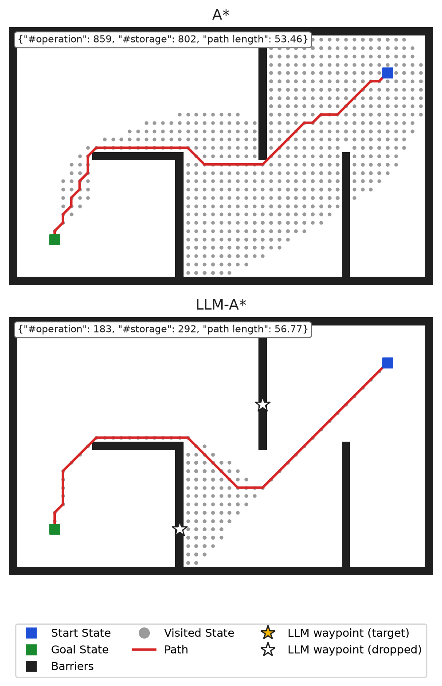
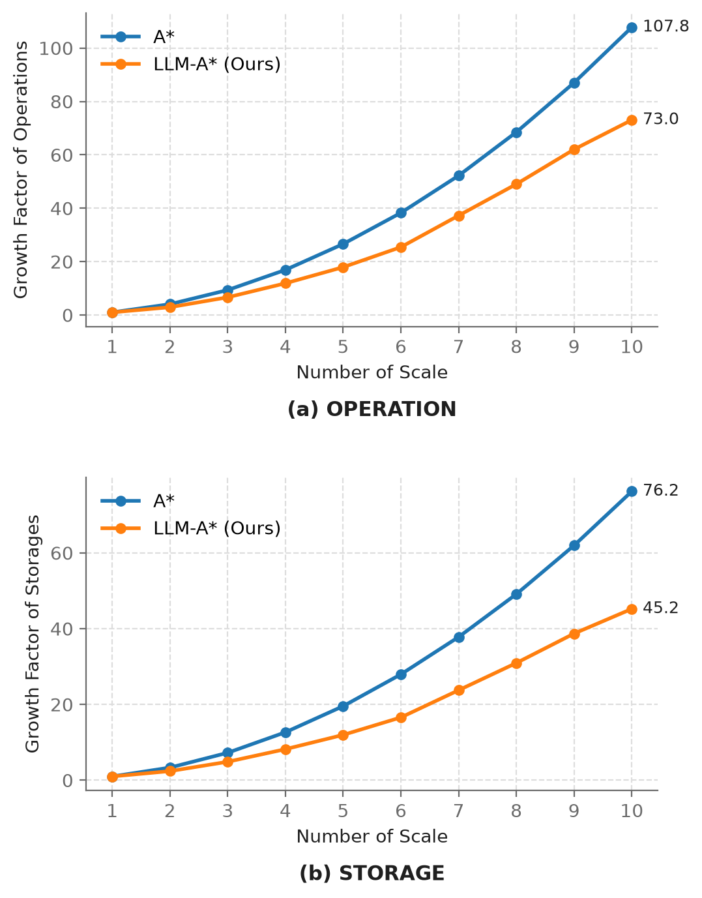

# Quorum-A*: Multi-View LLM Consensus for Robust Heuristic Search in Path Planning

This repository tests whether **better waypoints make LLM-guided A\* search more efficient**. It is work in
progress: step 1, reproducing LLM-A\*, is done; the method itself is next.

It builds on [LLM-A\*](https://arxiv.org/abs/2407.02511) (Meng et al., 2024). The original code is at
[SilinMeng0510/llm-astar](https://github.com/SilinMeng0510/llm-astar), and this is not the authors' repository.
In LLM-A\*, one LLM reads the map as text and proposes waypoints between the start and the goal. A\* then searches
toward one waypoint after another, so it expands far fewer states than plain A\*. A single LLM's waypoints are often
wrong, though. In our reproduction, on 25% of the queries every few-shot waypoint lay on a wall or at the map edge
and had to be dropped. Some kept waypoints led the search the wrong way.

**The idea.** Quorum-A\* picks waypoints in four stages:

1. Several LLM instances propose waypoints independently. Each one sees the map in a different encoding, for
   example coordinate text, a graph of wall corners, or the walls described in words.
2. Only the waypoints the instances agree on are kept, and an instance can veto another's waypoints.
3. Waypoints whose segments cross a wall, or that too few instances backed, are removed. (A multimodal model that
   checks the path on an image of the map is available with `--vision`; with GPT-4o mini it did not pay for its cost,
   so it is off by default.)
4. A\* searches through the waypoints that survive.

This makes more LLM calls per query than LLM-A\*. The question is whether the better waypoints are worth it: fewer
A\* operations and less memory, shorter paths, and fewer queries where the LLM's guidance fails.

- **Step 1, done: reproduce LLM-A\*.** We re-ran the paper's Table 1 and Figs. 1–3 with Llama-3-8B-Instruct,
  served locally by vLLM on one 24 GB GPU. The results are below. [REPRODUCTION.md](REPRODUCTION.md) has the
  details, every choice the paper left open, and why some numbers differ.
- **Step 2, next: build and measure Quorum-A\*.** The search code never talks to the LLM; it only takes
  a list of waypoints. The method is a new waypoint generator in `llmastar/waypoints/`, so the search stays the
  same, and the method shows up as new rows in the results table.

## Step 1 results: LLM-A\* reproduced

All 1,000 benchmark queries (100 maps × 10 start/goal pairs). Each value is relative to A\* (A\* = 100) and shown
as **ours / paper**. Lower is better for operations (states expanded) and storage (states kept in memory); a path
length of 100 means as short as A\*'s optimal path.

| Method | Operations | Storage | Path length |
|---|---|---|---|
| A\* | 100 / 100 | 100 / 100 | 100 / 100 |
| Dynamic WA\* | 59.49 / 60.91 | 78.65 / 78.53 | 100.25 / 100.24 |
| LLM-A\*, few-shot prompt | 42.99 / 44.59 | 62.83 / 64.02 | 102.27 / 102.47 |
| LLM-A\*, CoT prompt | 49.63 / 47.60 | 68.06 / 66.27 | 102.45 / 102.46 |
| LLM-A\*, RePE prompt | 69.70 / 64.08 | 84.31 / 80.19 | 102.42 / 102.54 |

With the few-shot prompt, LLM-A\* does 43% of A\*'s work and keeps 63% of its states, for paths 2.3% longer on
average. Every method above finds a valid path on all 1,000 queries. Letting the LLM draw the whole path itself
(LLM-only) gives a valid path only about 10% of the time (paper: 12–16%).

<p align="center">
  
  
</p>

Left (Fig. 1): A\* and LLM-A\* on the paper's example query. Both of Llama's waypoints here lie on a wall, so LLM-A\*
drops them (hollow stars), and it still needs only 183 operations against A\*'s 859. Right (Fig. 3): on maps enlarged up to
10×, A\*'s work grows 108× and LLM-A\*'s 73×. All figures are in [`outputs/figures/`](outputs/figures/).

## Quorum-A\* results

All 1,000 benchmark queries, relative to A\* (= 100); GPT-4o mini is the course's model. Weighted A\* (w = 2, no
LLM) is shown because LLM-A\* falls back to it when it has no waypoint.

| Method (GPT-4o mini) | Operations | Storage | Path length |
|---|---|---|---|
| LLM-A\*, few-shot prompt | 50.52 | 68.38 | 102.95 |
| Weighted A\* (w = 2) | 34.32 | 56.23 | 102.02 |
| **Quorum-A\*** | **33.95** | **56.08** | **102.00** |

Quorum-A\* does a third fewer operations than LLM-A\* with the same model. Most of that comes from rejecting the
waypoints that mislead the search, so on GPT-4o mini it matches weighted A\* rather than beating it. With stronger
models the same defaults pull ahead of weighted A\* (operations; win / tie / loss against weighted A\* per query,
paired Wilcoxon p):

| Model | LLM-A\* | Quorum-A\* | Quorum-A\* vs weighted A\* (34.32) |
|---|---|---|---|
| GPT-4o mini | 50.52 | 33.95 | 249 / 508 / 243, p = 0.6 |
| GPT-4.1 mini | 42.21 | 33.39 | 274 / 499 / 227, p = 0.012 |
| GPT-4.1 | 39.90 | 33.53 | 312 / 456 / 232, p < 0.001 |

Every table of the report (harder maps, cost, ablations, pilot) is in
[`outputs/report/tables.md`](outputs/report/tables.md), written by `python -m llmastar.report` from the per-query
CSVs; [`outputs/figures/fig8_models.png`](outputs/figures/fig8_models.png) draws the model comparison.

## Use it on your own maps

Needs Python 3.11 and `pip install -r requirements.txt`, nothing else (no GPU, no torch). The default model is
GPT-4o mini; any OpenAI-compatible endpoint (a local vLLM server, another provider) works by changing the model and
the base URL.

**API key.** Set `OPENAI_API_KEY`, or `openai.api_key` in Python, or pass `--api-key`. The key is never written to
the cache, the logs or the outputs.

**One query from Python** (the original repository's interface):

```python
from llmastar.pather import LLMAStar

query = {"start": [5, 5], "goal": [27, 15], "range_x": [0, 51], "range_y": [0, 31],
         "horizontal_barriers": [[10, 0, 25], [15, 30, 50]],   # [y, x_start, x_end]
         "vertical_barriers": [[25, 10, 22]]}                  # [x, y_start, y_end]
result = LLMAStar(llm="gpt", prompt="standard").searching(query=query, filepath="search.png")
print(result["operation"], result["storage"], result["length"], result["valid"])
```

Quorum-A\* has the same interface (it makes 3 LLM calls per query, one per view):

```python
from llmastar.pather import QuorumAStar
result = QuorumAStar(llm="gpt").searching(query=query, filepath="search.png")   # same result keys + "fallback"
```

`llm="gpt"` is GPT-4o mini with the paper's GPT prompts (`prompt` is `standard`, `cot` or `repe`). The result has
`operation` (states expanded), `storage` (states stored), `length` (path length), `valid`, `path`, `visited` and
`llm_output` (the start, the waypoints kept and the goal). `filepath` is optional and saves a plot.

**A whole map file from the command line.** `--dataset` takes the benchmark format
(`dataset/environment_50_30.json`: a list of maps, each with `id`, `range_x`, `range_y`, the two barrier lists and
`start_goal` pairs), a single map, a single query as above, or a list of queries.

```bash
export OPENAI_API_KEY=sk-...
python -m llmastar.run --method astar    --dataset my_maps.json --model gpt-4o-mini
python -m llmastar.run --method llmastar --dataset my_maps.json --model gpt-4o-mini \
  --base-url https://api.openai.com/v1 --prompt-set gpt --prompt standard
python -m llmastar.run --method quorumastar --dataset my_maps.json --model gpt-4o-mini \
  --base-url https://api.openai.com/v1
```

Each run writes `outputs/<model>/<run>.csv` with one row per query: `map_id, sg_idx, start, goal, method, prompt,
model, operation, storage, length, valid, valid_lenient, parse_ok, n_waypoints, n_targets, seconds, error,
llm_error`. A failed LLM call never stops a run: that query runs without waypoints (as LLM-A\* does when it gets
none), `llm_error` says why, and the run prints how many failed. Failures are not cached, so running the same
command again retries only them. Calls time out after 60 s and are retried up to 3 times on rate limits, timeouts
and server errors.

**Table 1 in one command** (all rows, then `outputs/<model>/summary.md`):

```bash
python -m llmastar.table1 --model gpt-4o-mini --base-url https://api.openai.com/v1 --prompt-set gpt
python -m llmastar.table1 --limit 50     # a quick pilot on the first 50 queries, local vLLM server
```

`--stop-newline --max-tokens 100` reproduces the original repository's sampling (`stop="\n"`, 100 tokens); it
cuts multi-line CoT and RePE answers, so the defaults are no stop and 2,048 tokens (REPRODUCTION.md).

## Setup

You need Linux, conda, and an NVIDIA GPU with at least 24 GB of memory. The GPU is only for the LLM runs; A\* and
Dynamic WA\* run on the CPU. You also need a Hugging Face account that has accepted the Llama 3 license on the
[model page](https://huggingface.co/meta-llama/Meta-Llama-3-8B-Instruct).

There are two conda envs: `vllm` serves the model and `llmastar` runs the experiments.

```bash
git clone https://github.com/skyachieved/llm-astar-optimized.git
cd llm-astar-optimized

# experiments (no torch needed)
conda create -n llmastar python=3.11 -y
conda activate llmastar
pip install -r requirements.txt
pytest -q

# model server
conda create -n vllm python=3.11 -y
conda activate vllm
pip install "vllm==0.11.0" "transformers>=4.56,<5"
hf auth login
hf download meta-llama/Meta-Llama-3-8B-Instruct --local-dir ~/models/Meta-Llama-3-8B-Instruct --exclude "original/*"
```

- `pytest -q` checks that A\* on the paper's Fig. 1 query gives 859 operations, 802 storage and length 53.46.
- `hf auth login` asks for a Hugging Face access token with read permission.
- transformers stays below 5 because vLLM 0.11.0 does not start with transformers 5.
- The model download is about 16 GB.

## Run the experiments

**1. Start the model server** in its own terminal (or tmux window) and leave it running. It is ready when it
prints `Application startup complete`.

```bash
conda activate vllm
CUDA_VISIBLE_DEVICES=0 vllm serve ~/models/Meta-Llama-3-8B-Instruct \
  --served-model-name llama-3-8b-instruct --host 127.0.0.1 --port 8000 \
  --dtype bfloat16 --max-model-len 8192 --gpu-memory-utilization 0.90 \
  --generation-config vllm --seed 0
```

- `CUDA_VISIBLE_DEVICES=0` picks the GPU. On a machine with different GPU models, put `CUDA_DEVICE_ORDER=PCI_BUS_ID`
  in front of it so the number matches `nvidia-smi`.
- `--generation-config vllm` makes vLLM ignore the model's default sampling settings. The client always sends
  temperature 0.

**2. Run everything** in a second terminal, from the repository folder:

```bash
conda activate llmastar
export OPENAI_API_KEY=dummy

# baselines (CPU only)
python -m llmastar.run --method astar --jobs 8
python -m llmastar.run --method dwastar --jobs 8

# LLM-A* and LLM-only with the paper's three prompts
for p in standard cot repe; do
  python -m llmastar.run --method llmastar --prompt $p --jobs 8 --workers 32
  python -m llmastar.run --method llm_only --prompt $p --jobs 8 --workers 32
done

# Fig. 3 data: 10 sampled queries on maps enlarged 1x to 10x
python -m llmastar.scale --jobs 8

# the table and the figures
python -m llmastar.summary
python -m llmastar.figures
```

- `OPENAI_API_KEY` must be set, but vLLM accepts any value.
- `--jobs` is the number of CPU worker processes; lower it on a small machine. `--workers` is the number of
  concurrent LLM requests.
- On one RTX A5000, the 3,000 LLM calls took about 8 minutes, and the Fig. 3 searches about 2.5 minutes.
- `python -m llmastar.summary` prints the table and writes `outputs/llama-3-8b-instruct/summary.md`.
  `python -m llmastar.figures` writes the figures to `outputs/figures/`.
- Every LLM answer is cached in `.cache/llm/`, so running a command again sends no new requests. The `llm_only` runs
  reuse the answers from the `llmastar` runs.
- To try a quick pilot first, add `--limit 50` to the LLM runs (the first 50 queries).
- These commands overwrite the results committed in `outputs/`; `git checkout outputs` brings them back.

**3. Quorum-A\* on GPT-4o mini** (the course's model; no GPU needed). One script runs every experiment of the
report: the four methods on all 1,000 queries, the ablations (first 300 queries), the Table 1 rows on GPT-4o mini,
and the generalization check on harder generated maps (`dataset/generated/`, made by `python -m
llmastar.generate_maps`). It reruns any command whose raw log shows a failed call (rate limit, timeout); cached
answers are reused, so a rerun costs nothing.

```bash
read -rsp "OpenAI key: " OPENAI_API_KEY; echo; export OPENAI_API_KEY   # never written to disk
bash experiments/gpt-4o-mini.sh all 2>&1 | tee experiments_gpt.log      # or main | free | ablations | table1 | hard
```

Other models run the same comparison with the same defaults: `experiments/other-models.sh <model>` for other
OpenAI chat models (gpt-4.1-mini, gpt-4.1; gpt-4.1-nano was retired by OpenAI on 2026-10-23), and
`experiments/qwen.sh` for an open model (Qwen2.5-VL-7B-Instruct on a local vLLM server; its header has the server
command). Then the report's tables and the model figure:

```bash
python -m llmastar.report               # outputs/report/tables.md
python -m llmastar.figures.fig8_models  # outputs/figures/fig8_models.png
```

## What's where

```
llmastar/run.py        one method over the benchmark -> outputs/<model>/<run>.csv
llmastar/summary.py    the results table, next to the paper's numbers
llmastar/report.py     the report's tables across models (paired tests in llmastar/stats.py)
llmastar/quorumastar/  Quorum-A*'s waypoint step (views, vote, checks)
experiments/           one script per model: every run of the report
llmastar/scale.py      the Fig. 3 scalability run
llmastar/figures/      Figs. 1-8, built from outputs/ only
llmastar/pather/       A*, Dynamic WA*, LLM-A* (search only, no LLM code)
llmastar/waypoints/    waypoint generators: the paper's prompts; new methods register here
llmastar/model/        OpenAI-compatible chat client with an on-disk response cache
dataset/               the benchmark: 100 maps x 10 start/goal pairs
outputs/               our results: per-query CSVs, summary.md, search traces, figures
tests/                 unit tests (pytest)
REPRODUCTION.md        what we changed in the original code and why, deviations from the paper, why numbers differ
```

## Inspirations

Quorum-A\* combines ideas from these papers. Putting these views together as voters for waypoints is our contribution,
and it is a hypothesis that our pilot experiments test, not a result.

- **MedRAG** (Xiong, Jin, Lu, Zhang, *Benchmarking Retrieval-Augmented Generation for Medicine*, Findings of ACL 2024,
  [arXiv:2402.13178](https://arxiv.org/abs/2402.13178)): several retrievers are fused by reciprocal rank fusion. This is
  the analogue of our several views.
- **Talk like a Graph** (Fatemi, Halcrow, Perozzi, ICLR 2024, [arXiv:2310.04560](https://arxiv.org/abs/2310.04560)): how a
  graph is written as text changes LLM answers; the incident encoding did best for most prompting methods. Our corner
  view uses it.
- **Do LLMs Build Spatial World Models?** (Li, Zhu, Das, Dube, 2026,
  [arXiv:2604.10690](https://arxiv.org/abs/2604.10690), preprint): adjacency lists beat grid layouts on mazes.
- **Self-consistency** (Wang et al., ICLR 2023), **MMP-A\*** (Ha et al., 2026,
  [arXiv:2601.01910](https://arxiv.org/abs/2601.01910)) and **weighted A\*** (Pohl, 1970): see METHOD.md for how each is used.

## Credit

LLM-A\* and the benchmark come from the paper below and its [original code](https://github.com/SilinMeng0510/llm-astar).

```
@article{meng2024llm,
  title={LLM-A*: Large Language Model Enhanced Incremental Heuristic Search on Path Planning},
  author={Meng, Silin and Wang, Yiwei and Yang, Cheng-Fu and Peng, Nanyun and Chang, Kai-Wei},
  journal={arXiv preprint arXiv:2407.02511},
  year={2024}
}
```

MIT license; see `LICENSE`.
