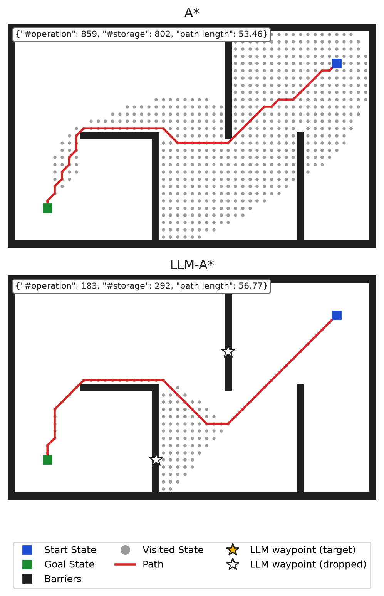
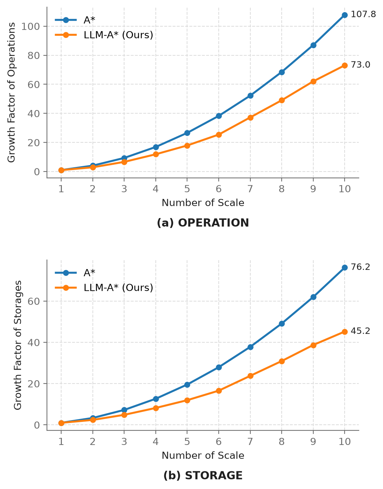

# LLM-A* testbed: can we make A* cheaper?

This repository asks one question: **can A\* path search do less work and use less memory, and still find
near-optimal paths?**

It starts from [LLM-A\*](https://arxiv.org/abs/2407.02511) (Meng et al., 2024). The original code is at
[SilinMeng0510/llm-astar](https://github.com/SilinMeng0510/llm-astar), and this is not the authors' repository.
In LLM-A\*, a large language model reads the map and proposes a few waypoints between the start and the goal. A\*
then searches toward one waypoint after another, so it explores much less of the map than plain A\*.

- **Step 1, done: reproduce the paper.** We re-ran Table 1 and Figs. 1–3 with Llama-3-8B-Instruct, served locally
  by vLLM on one 24 GB GPU. The results are below. [REPRODUCTION.md](REPRODUCTION.md) has the details, every
  choice the paper left open, and why some numbers differ.
- **Next: new ways of choosing waypoints.** The search code never talks to the LLM; it only takes a list of
  waypoints. A new method is a new waypoint generator in `llmastar/waypoints/`, and it shows up as a new row in
  the results table.

## Results

All 1,000 benchmark queries (100 maps × 10 start/goal pairs). Each value is relative to A\* (A\* = 100) and shown
as **ours / paper**. Lower is better for operations (states expanded) and storage (states kept in memory); a path
length of 100 means as short as A\*'s optimal path.

| Method | Operations | Storage | Path length |
|---|---|---|---|
| A\* | 100 / 100 | 100 / 100 | 100 / 100 |
| Dynamic WA\* | 59.49 / 60.91 | 78.65 / 78.53 | 100.25 / 100.24 |
| LLM-A\*, few-shot prompt | 42.99 / 44.59 | 62.83 / 64.02 | 102.27 / 102.47 |
| LLM-A\*, CoT prompt | 49.63 / 47.60 | 68.06 / 66.27 | 102.45 / 102.46 |
| LLM-A\*, RePE prompt | 69.70 / 64.08 | 84.31 / 80.19 | 102.42 / 102.54 |

With the few-shot prompt, LLM-A\* does 43% of A\*'s work and keeps 63% of its states, for paths 2.3% longer on
average. Every method above finds a valid path on all 1,000 queries. Letting the LLM draw the whole path itself
(LLM-only) gives a valid path only about 10% of the time (paper: 12–16%).

<p align="center">
  
  
</p>

Left (Fig. 1): A\* and LLM-A\* on the paper's example query. Both of Llama's waypoints here lie on a wall, so LLM-A\*
drops them (hollow stars), and it still needs only 183 operations against A\*'s 859. Right (Fig. 3): on maps enlarged up to
10×, A\*'s work grows 108× and LLM-A\*'s 73×. All figures are in [`outputs/figures/`](outputs/figures/).

## Setup

You need Linux, conda, and an NVIDIA GPU with at least 24 GB of memory. The GPU is only for the LLM runs; A\* and
Dynamic WA\* run on the CPU. You also need a Hugging Face account that has accepted the Llama 3 license on the
[model page](https://huggingface.co/meta-llama/Meta-Llama-3-8B-Instruct).

There are two conda envs: `vllm` serves the model and `llmastar` runs the experiments.

```bash
git clone https://github.com/skyachieved/llm-astar-optimized.git
cd llm-astar-optimized

# experiments (no torch needed)
conda create -n llmastar python=3.11 -y
conda activate llmastar
pip install -r requirements.txt
pytest -q

# model server
conda create -n vllm python=3.11 -y
conda activate vllm
pip install "vllm==0.11.0" "transformers>=4.56,<5"
hf auth login
hf download meta-llama/Meta-Llama-3-8B-Instruct --local-dir ~/models/Meta-Llama-3-8B-Instruct --exclude "original/*"
```

- `pytest -q` checks that A\* on the paper's Fig. 1 query gives 859 operations, 802 storage and length 53.46.
- `hf auth login` asks for a Hugging Face access token with read permission.
- transformers stays below 5 because vLLM 0.11.0 does not start with transformers 5.
- The model download is about 16 GB.

## Run the experiments

**1. Start the model server** in its own terminal (or tmux window) and leave it running. It is ready when it
prints `Application startup complete`.

```bash
conda activate vllm
CUDA_VISIBLE_DEVICES=0 vllm serve ~/models/Meta-Llama-3-8B-Instruct \
  --served-model-name llama-3-8b-instruct --host 127.0.0.1 --port 8000 \
  --dtype bfloat16 --max-model-len 8192 --gpu-memory-utilization 0.90 \
  --generation-config vllm --seed 0
```

- `CUDA_VISIBLE_DEVICES=0` picks the GPU. On a machine with different GPU models, put `CUDA_DEVICE_ORDER=PCI_BUS_ID`
  in front of it so the number matches `nvidia-smi`.
- `--generation-config vllm` makes vLLM ignore the model's default sampling settings. The client always sends
  temperature 0.

**2. Run everything** in a second terminal, from the repository folder:

```bash
conda activate llmastar
export OPENAI_API_KEY=dummy

# baselines (CPU only)
python -m llmastar.run --method astar --jobs 8
python -m llmastar.run --method dwastar --jobs 8

# LLM-A* and LLM-only with the paper's three prompts
for p in standard cot repe; do
  python -m llmastar.run --method llmastar --prompt $p --jobs 8 --workers 32
  python -m llmastar.run --method llm_only --prompt $p --jobs 8 --workers 32
done

# Fig. 3 data: 10 sampled queries on maps enlarged 1x to 10x
python -m llmastar.scale --jobs 8

# the table and the figures
python -m llmastar.summary
python -m llmastar.figures
```

- `OPENAI_API_KEY` must be set, but vLLM accepts any value.
- `--jobs` is the number of CPU worker processes; lower it on a small machine. `--workers` is the number of
  concurrent LLM requests.
- On one RTX A5000, the 3,000 LLM calls took about 8 minutes, and the Fig. 3 searches about 2.5 minutes.
- `python -m llmastar.summary` prints the table and writes `outputs/llama-3-8b-instruct/summary.md`.
  `python -m llmastar.figures` writes the figures to `outputs/figures/`.
- Every LLM answer is cached in `.cache/llm/`, so running a command again sends no new requests. The `llm_only` runs
  reuse the answers from the `llmastar` runs.
- To try a quick pilot first, add `--limit 50` to the LLM runs (the first 50 queries).
- These commands overwrite the results committed in `outputs/`; `git checkout outputs` brings them back.

## What's where

```
llmastar/run.py        one method over the benchmark -> outputs/<model>/<run>.csv
llmastar/summary.py    the results table, next to the paper's numbers
llmastar/scale.py      the Fig. 3 scalability run
llmastar/figures/      Figs. 1-3, built from outputs/ only
llmastar/pather/       A*, Dynamic WA*, LLM-A* (search only, no LLM code)
llmastar/waypoints/    waypoint generators: the paper's prompts; new methods register here
llmastar/model/        OpenAI-compatible chat client with an on-disk response cache
dataset/               the benchmark: 100 maps x 10 start/goal pairs
outputs/               our results: per-query CSVs, summary.md, search traces, figures
tests/                 unit tests (pytest)
REPRODUCTION.md        what we changed in the original code and why, deviations from the paper, why numbers differ
```

## Credit

LLM-A\* and the benchmark come from the paper below and its [original code](https://github.com/SilinMeng0510/llm-astar).

```
@article{meng2024llm,
  title={LLM-A*: Large Language Model Enhanced Incremental Heuristic Search on Path Planning},
  author={Meng, Silin and Wang, Yiwei and Yang, Cheng-Fu and Peng, Nanyun and Chang, Kai-Wei},
  journal={arXiv preprint arXiv:2407.02511},
  year={2024}
}
```

MIT license; see `LICENSE`.
